# Práctica 6 — Estándares de accesibilidad web

**Memoria del análisis de accesibilidad de la página «EPS Zamora»**

| Dato | Valor |
|---|---|
| Asignatura | Evaluación y Diseño de Interfaces |
| Grado | Ingeniería Informática en Sistemas de Información (GIISI) |
| Centro | Escuela Politécnica Superior de Zamora — Universidad de Salamanca |
| Grupo | 8 |
| Integrantes | Laura Munera Vahos, Iago Fernández Varela e Inés Otero Amon |
| Página analizada | `index.html`, `styles.css` y `script.js` (versión original) |
| Fecha | Octubre de 2026 |

---

## 1. Objetivo

En esta práctica teníamos que analizar la accesibilidad de una página web sencilla usando los criterios de la WAI (WCAG) y después corregir los problemas que encontrásemos.

Para ello hemos combinado dos formas de revisar la página:

1. **Validadores automáticos**, que detectan algunos errores por sí solos.
2. **Revisión manual**, porque hay muchas cosas que ningún validador puede comprobar (si el menú se puede usar con teclado, si se ve el foco, si el texto alternativo tiene sentido, etc.).

El resultado del trabajo es este documento: qué problemas hemos encontrado, con qué herramienta, cómo se ven en la página y qué habría que cambiar para solucionarlos.

---

## 2. Página analizada

La página está hecha con tres archivos: `index.html` para la estructura, `styles.css` para los estilos y `script.js` para el comportamiento de algunos botones y enlaces.

Simula la portada de la Escuela Politécnica Superior de Zamora. Tiene una cabecera con el logotipo y un menú con tres desplegables, un banner con un buscador de dos campos, tres columnas (accesos y filtros, titulaciones y formulario, agenda e investigación), un aviso de cookies fijo en la parte de abajo y un pie con los datos de contacto.

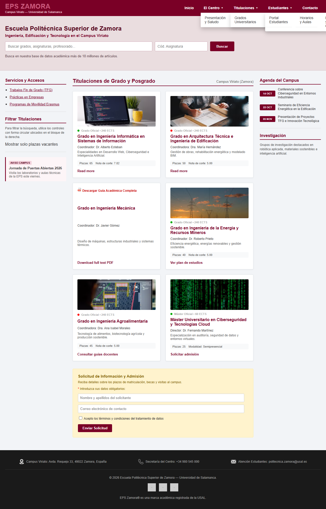

*Figura 1. La página original completa, antes de corregir nada.*

---

## 3. Configuración empleada

### 3.1. Validadores

La práctica pide usar dos de los tres validadores que se proponen. Nosotros hemos elegido **T.A.W.** y **AChecker**:

| Validador | Dirección | Configuración |
|---|---|---|
| T.A.W. | https://www.tawdis.net | Nivel AA, WCAG 2.0, navegador de escritorio, HTML y CSS |
| AChecker | https://achecks.org/achecker | Revisión por URL, WCAG 2.0 AA |
| MAUVE++ | https://mauve.isti.cnr.it | No lo hemos usado como validador principal |

Estos dos validadores analizan una **dirección web pública**, así que hay que lanzarlos cuando la página esté subida al servidor (lo explicamos en el apartado 8).

Mientras preparábamos la publicación, para tener resultados desde el primer momento, hemos usado dos comprobaciones automáticas que funcionan en local:

- **Validador de HTML del W3C** (`validator.w3.org/nu`), que revisa el marcado.
- **axe-core 4.10.2**, una librería que aplica reglas WCAG 2.0 y 2.1 de nivel A y AA sobre la página ya cargada en el navegador.

Los resultados que aparecen en el apartado 5 son los de estas dos herramientas.

### 3.2. Entorno de análisis

| Elemento | Detalle |
|---|---|
| Navegador | Chrome (Chromium) de escritorio |
| Tamaño de ventana | 1280 × 900 px, zoom al 100 % |
| Sistema operativo | Windows 11 |
| Norma de referencia | WCAG 2.0 nivel AA, añadiendo criterios de 2.1 y 2.2 |
| Tecnologías revisadas | HTML y CSS |

Hemos fijado el ancho en **1280 px**, que es justo el `max-width` del contenedor de la página. A partir de ahí el diseño ya no cambia, así que las capturas coinciden con lo que se ve en cualquier navegador maximizado. Si la ventana es más estrecha de 1150 px la rejilla no cabe, las tarjetas pasan a una sola columna y el contenido se sale por la derecha.

### 3.3. Herramientas de apoyo

- **Inspector del navegador**: para mirar el árbol de accesibilidad, el orden de tabulación y los estilos del foco.
- **Calculadora de contraste**: para comprobar los colores con números, no "a ojo".
- **Teclado**: hemos recorrido la página entera con Tab, Mayús+Tab, Intro, Espacio y Escape.

---

## 4. Metodología

El trabajo lo hemos hecho entre los tres. Primero revisamos el código y la página por separado, después pusimos en común lo que había encontrado cada uno y al final lo comprobamos todo juntos.

Para el análisis seguimos este orden:

1. Pasar las herramientas automáticas y apuntar los mensajes.
2. Revisar a mano lo que las herramientas no ven.
3. Comprobar si cada aviso era un problema real o un falso positivo.
4. Anotar la incidencia con su criterio WCAG y su nivel (A o AA).
5. Pensar la solución y escribir el cambio de código.

Para las capturas marcamos cada elemento afectado con un **recuadro rojo discontinuo** y un **número**, que se explica en el pie de cada figura.

---

## 5. Incidencias encontradas

### 5.1. Resumen

| ID | Incidencia | Criterio WCAG | Nivel | Detección | Gravedad |
|---|---|---|---|---|---|
| I-01 | La página está en español pero pone `lang="en"` | 3.1.1 | A | Automática + manual | Crítica |
| I-02 | No hay `<h1>` y se salta del `<h4>` al `<h6>` | 1.3.1 / 2.4.6 | A / AA | Automática | Alta |
| I-03 | El logotipo «EPS ZAMORA» tiene poco contraste (2,81:1) | 1.4.3 | AA | Automática | Alta |
| I-04 | El texto «Grado Oficial • 240 ECTS» tiene poco contraste (2,32:1) | 1.4.3 | AA | Automática | Alta |
| I-05 | Los enlaces de redes sociales no tienen nombre | 2.4.4 / 4.1.2 | A | Automática | Crítica |
| I-06 | Hay dos elementos con el mismo `id` (`email-field`) | 4.1.1 | A | Automática | Alta |
| I-07 | HTML mal cerrado: un `<div>` dentro de un `<p>` | 4.1.1 | A | Automática | Media |
| I-08 | El menú desplegable solo se abre con el ratón | 2.1.1 / 4.1.2 | A | Manual | Crítica |
| I-09 | Los paneles del menú se muestran siempre y se solapan entre sí | 1.4.10 | AA | Manual | Alta |
| I-10 | No se ve el foco en ningún elemento | 2.4.7 | AA | Manual | Crítica |
| I-11 | Los campos del buscador no tienen etiqueta | 3.3.2 / 1.3.1 | A | Manual | Alta |
| I-12 | Los campos del formulario no tienen etiqueta | 3.3.2 | A | Manual | Crítica |
| I-13 | La etiqueta del checkbox apunta a otro campo | 1.3.1 / 3.3.2 / 4.1.2 | A | Manual | Crítica |
| I-14 | El filtro «Mostrar solo plazas vacantes» no existe como control | 4.1.2 / 2.1.1 | A | Manual | Alta |
| I-15 | Hay enlaces falsos hechos con `<li>` y `<span>` | 2.1.1 / 4.1.2 / 2.4.4 | A | Manual | Alta |
| I-16 | El botón «Enviar Solicitud» es un `<div>` | 2.1.1 / 4.1.2 | A | Manual | Crítica |
| I-17 | El estado de la titulación se indica solo con un color | 1.4.1 | A | Manual | Alta |
| I-18 | Textos alternativos mal puestos o vacíos | 1.1.1 / 3.1.2 | A / AA | Manual | Media |
| I-19 | Dos enlaces «Read more» con el mismo texto | 2.4.4 | A | Manual | Media |
| I-20 | Hay un audio que se reproduce solo y no se puede parar | 1.4.2 | A | Manual | Alta |
| I-21 | El aviso de cookies tapa contenido y no se puede cerrar | 2.4.11 | AA | Manual | Media |
| I-22 | No hay enlace para saltar al contenido y el banner queda fuera de los *landmarks* | 2.4.1 | A | Manual + automática | Media |
| I-23 | Falta la etiqueta `meta viewport` | 1.4.10 | AA | Manual | Media |
| I-24 | El correo es un `type="text"` sin `autocomplete` | 1.3.5 | AA | Manual | Baja |
| I-25 | Un enlace abre otra pestaña sin avisar | 3.2.5 | AAA | Manual | Baja |

En total hemos encontrado **25 incidencias**. Solo **7** las detectan las herramientas automáticas; las otras **18** han salido de la revisión manual. Por gravedad: 7 críticas, 10 altas, 6 medias y 2 bajas.

---

### 5.2. Incidencias detectadas automáticamente

Esto es lo que nos devolvió cada herramienta:

| Herramienta | Resultado |
|---|---|
| Validador W3C | 3 errores: `id` duplicado, `<div>` dentro de `<p>` y salto de nivel en los encabezados. 3 avisos: idioma equivocado, falta de `h1` y primera aparición del `id` duplicado. |
| axe-core (A y AA) | 2 reglas incumplidas: contraste de color (6 elementos) y enlaces sin nombre (3 elementos). 3 comprobaciones que no pudo resolver: contraste (6), `id` duplicado (1) y audio automático (1). |
| axe-core (buenas prácticas) | Orden de encabezados, falta de `h1`, dos `aside` sin nombre que los distinga y contenido fuera de los *landmarks*. |

#### I-01 · Idioma del documento incorrecto (3.1.1, nivel A)

```html
<html lang="en">
```

La página entera está en español, así que un lector de pantalla intentaría leerla con voz inglesa y se entendería fatal. El validador del W3C lo avisa directamente: *«This document appears to be written in Spanish but the "html" start tag has "lang="en"»*. Es un cambio de una palabra.

#### I-02 · Sin `<h1>` y salto en la jerarquía de encabezados (1.3.1 / 2.4.6)

El título grande de la página («Escuela Politécnica Superior de Zamora») está marcado como `<h2>` y no hay ningún `<h1>`. Además, el título del formulario es un `<h6>` justo después de un `<h4>`.

El validador del W3C lo dice así:

> *The heading "h6" (with computed level 6) follows the heading "h4" (with computed level 4), skipping 1 heading level.*

> *This document has heading elements but none of them has a computed heading level of 1.*

Para quien navega con lector de pantalla, los encabezados son el índice de la página; si están mal puestos, es más difícil orientarse. En la **Figura 9** está marcado con el número **1** el `h6` del formulario.

#### I-03 · Contraste insuficiente en el logotipo (1.4.3, nivel AA)

El texto del logotipo es `#c85a7c` sobre el fondo `#7a0026`, lo que da **2,81:1**. Como es texto grande y en negrita, el mínimo es **3:1**, así que se queda corto por poco. Se arregla cambiando el color del texto.

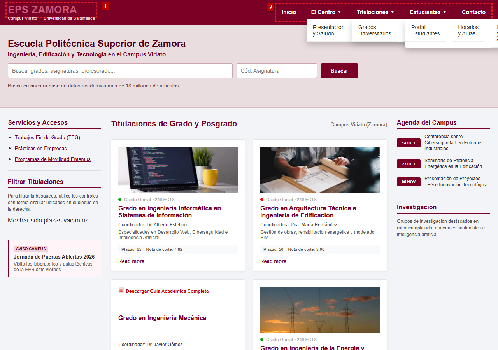

*Figura 2. (1) Logotipo «EPS ZAMORA», con un contraste de 2,81:1. (2) Menú principal, que además solo responde al ratón (I-08).*

#### I-04 · Contraste insuficiente en los metadatos de las tarjetas (1.4.3, nivel AA)

El texto «Grado Oficial • 240 ECTS» es `#aaa` sobre blanco: **2,32:1**, cuando necesita 4,5:1. Pasa en las seis tarjetas.

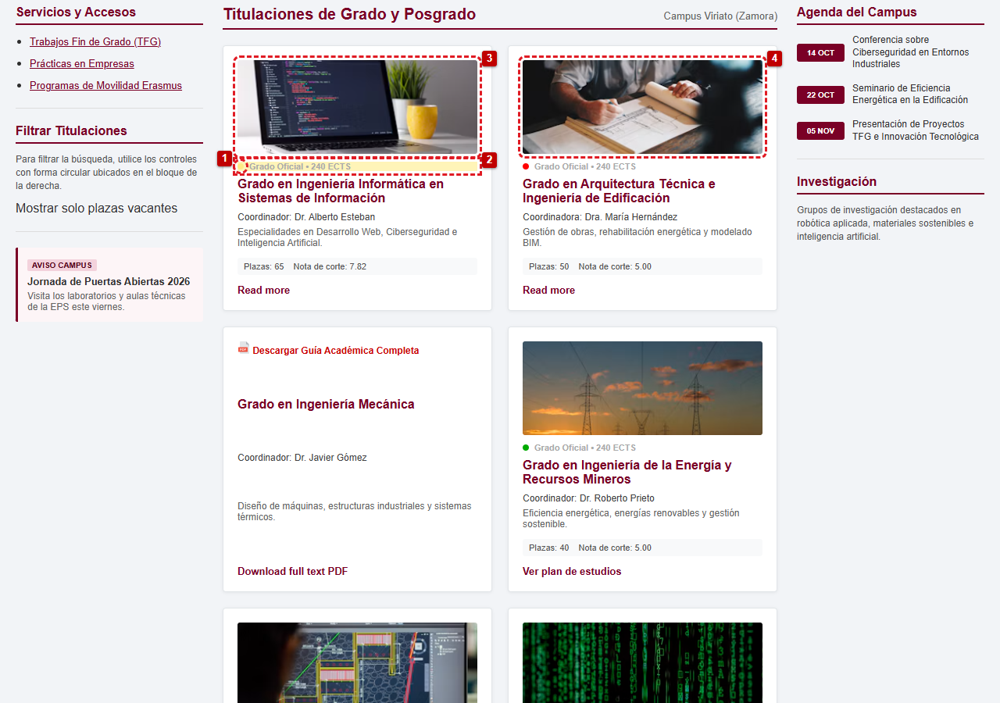

*Figura 3. (1) El estado de la titulación se marca solo con un punto verde o rojo. (2) Metadato con 2,32:1 de contraste. (3) Imagen con un `alt` redundante. (4) Imagen informativa con `alt` vacío.*

#### I-05 · Enlaces de redes sociales sin nombre accesible (2.4.4 / 4.1.2, nivel A)

Los tres iconos del pie son enlaces, pero dentro solo tienen una imagen con `alt=""` y no llevan ni texto ni `aria-label`. Un lector de pantalla dice «enlace» y no dice a dónde va.

```html
<a href="#"></a>
```

axe-core lo marca como problema serio en los 3 enlaces.


*Figura 4. (1), (2) y (3) Enlaces de redes sociales sin nombre accesible. (4) El párrafo final, que tiene el HTML mal cerrado (I-07).*

#### I-06 · Identificador duplicado (4.1.1, nivel A)

`email-field` se usa dos veces: en el campo de correo y en el checkbox de aceptar. El validador lo da como error (*Duplicate ID "email-field"*). El problema no es solo que el HTML esté mal, sino que la etiqueta del checkbox acaba asociada al campo de texto (I-13).

#### I-07 · Marcado mal formado (4.1.1, nivel A)

```html
<p class="trademark-text">EPS Zamora® es una marca académica registrada de la USAL.<div></p></div>
```

Hay un `<div>` dentro de un `<p>` y sobra un cierre. El validador responde: *«No "p" element in scope but a "p" end tag seen»*.

---

### 5.3. Incidencias detectadas en la revisión manual

#### I-08 · Menú desplegable inoperable con teclado (2.1.1 / 4.1.2, nivel A)

Los desplegables se abren solo por CSS:

```css
.dropdown:hover .dropdown-content { display: block; }
```

Esto significa que hay que pasar el ratón por encima. Con teclado no hay forma de abrirlos: no hay `focus`, ni `Enter`, ni `Espacio`, ni `aria-expanded`. Tampoco funcionan en una pantalla táctil. Y encima, por un conflicto de especificidad en el CSS, los tres paneles se muestran siempre abiertos y superpuestos (lo vemos en la incidencia I-09).

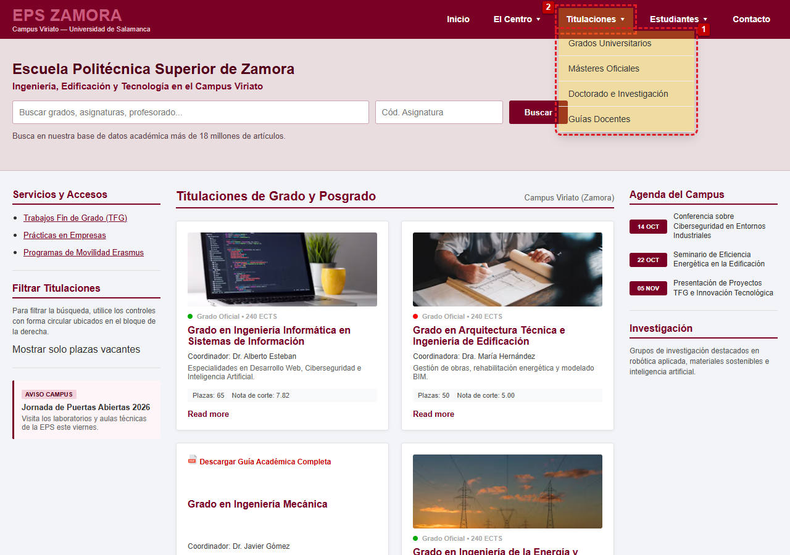

*Figura 5. (1) Submenú «Titulaciones» abierto. (2) El botón que lo abre. Solo aparece mientras el ratón está encima. En la captura hemos forzado el despliegue para poder fotografiarlo: en la página real los tres paneles se ven siempre abiertos y en horizontal, porque la regla `.main-nav ul` (que pone `display: flex`) gana por especificidad a `.dropdown-content` (que pone `display: none`).*

#### I-09 · Los paneles del menú se muestran siempre y se solapan (1.4.10, nivel AA)

Los tres submenús aparecen abiertos a la vez, unos encima de otros, aunque el ratón no esté encima de ninguno. La culpa es de un **conflicto de especificidad** en la hoja de estilos:

```css
.main-nav ul { display: flex; gap: 15px; }        /* especificidad (0,1,1) */
.dropdown-content { display: none; }              /* especificidad (0,1,0) */
```

La regla de `.main-nav ul` gana, así que el `display: none` de los desplegables **nunca se aplica**. Los paneles se pintan siempre y, al ser la lista `flex`, sus cuatro enlaces se reparten en una fila y se comprimen hasta que el texto de uno se monta sobre el siguiente. El tercer panel, además, se sale del ancho de la página: el documento pasa de 1280 a **1471 px** de ancho y aparece scroll horizontal.

En la **Figura 6** se ven los tres paneles superpuestos: cada uno empieza antes de que termine el anterior y la parte tapada ya no se puede leer.

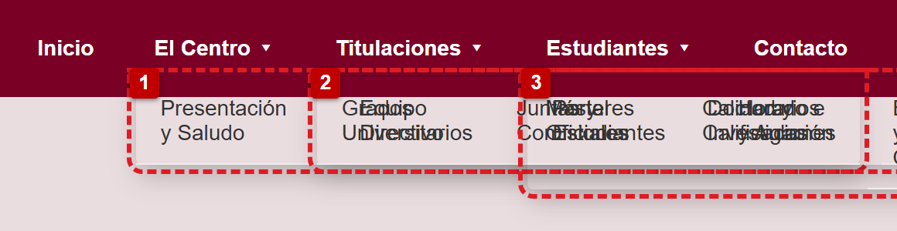

*Figura 6. (1) Panel de «El Centro». (2) Panel de «Titulaciones», que se dibuja encima del anterior. (3) Panel de «Estudiantes», que tapa a los dos y se sale por la derecha de la página. El texto de los enlaces se mezcla porque los paneles se comprimen en una sola fila.*

#### I-10 · Indicador de foco eliminado (2.4.7, nivel AA)

```css
*:focus { outline: none !important; }
```

Esta línea quita el recuadro de foco de todos los elementos de la página. En la **Figura 7** el enlace «Inicio» tiene el foco (lo comprobamos con `document.activeElement`) y su estilo calculado es `outline-style: none`, así que no se nota nada. Alguien que navegue con Tab se pierde.

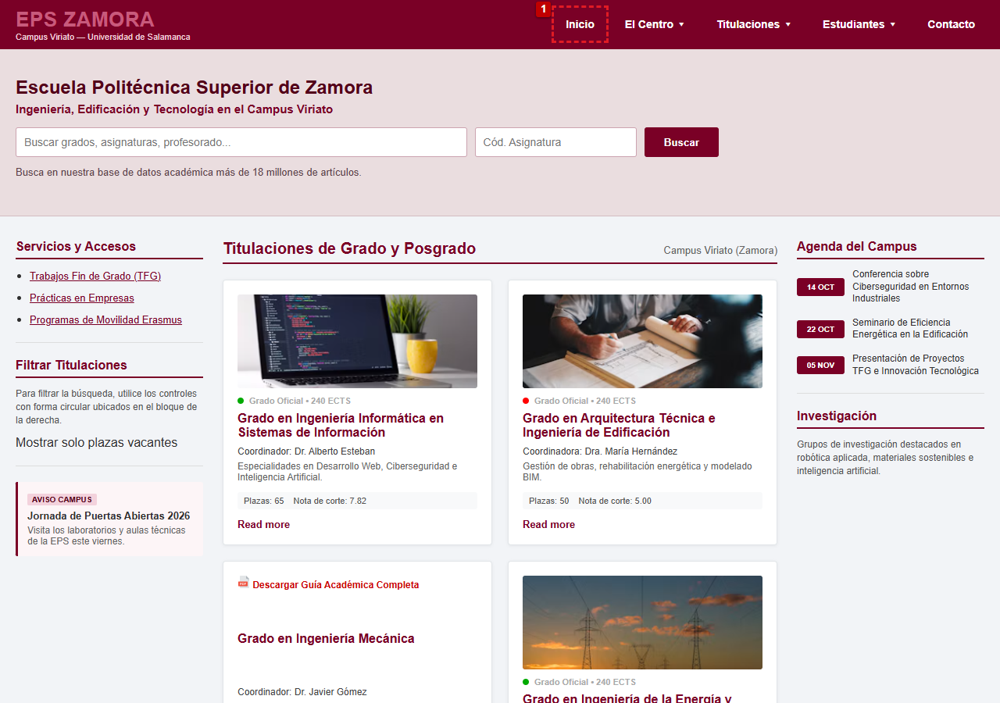

*Figura 7. El enlace «Inicio» (1) tiene el foco, pero no se ve ningún indicador.*

#### I-11 · Campos del buscador sin etiqueta (3.3.2 / 1.3.1, nivel A)

```html
<input type="text" placeholder="Buscar grados, asignaturas, profesorado..." id="search-input">
<input type="text" placeholder="Cód. Asignatura">
```

Solo hay `placeholder`. Ese texto desaparece en cuanto escribes y no sirve como etiqueta para un lector de pantalla. Tampoco hay un `<form>` de búsqueda como tal.

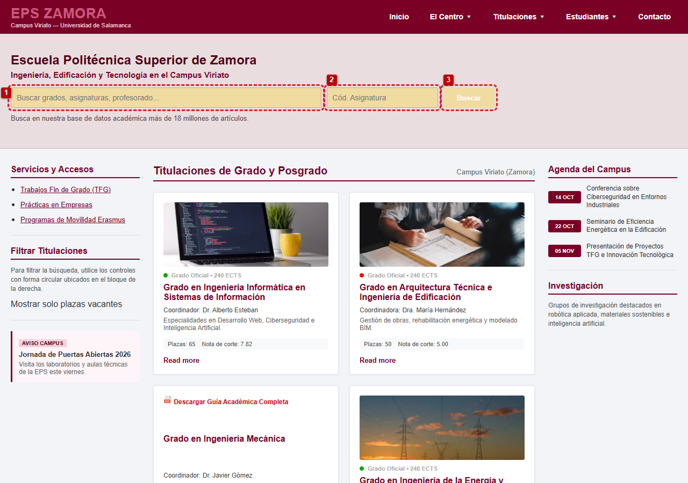

*Figura 8. (1) Campo general y (2) campo de código, los dos sin etiqueta. (3) Botón «Buscar».*

#### I-12 · Formulario sin etiquetas (3.3.2, nivel A)

Los campos de nombre y correo vuelven a usar solo `placeholder`. No hay `<label>`, ni `required`, ni `autocomplete`, ni mensajes de error.

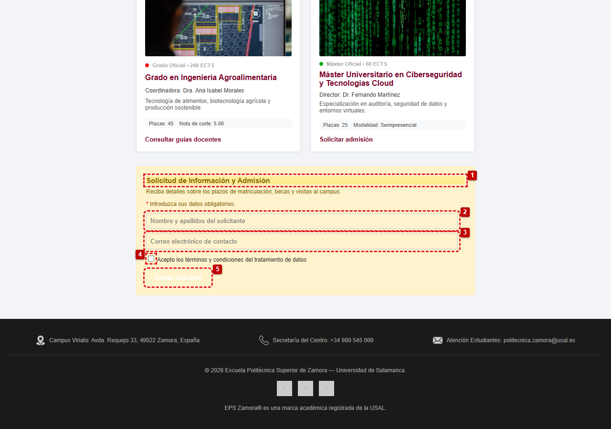

*Figura 9. (1) Título del formulario en `<h6>`. (2) y (3) Campos sin etiqueta. (4) Checkbox mal asociado. (5) Botón hecho con un `<div>`.*

#### I-13 · Etiqueta del *checkbox* mal asociada (1.3.1 / 3.3.2 / 4.1.2)

```html
<input type="checkbox" id="email-field">
<label for="email-field">Acepto los términos y condiciones…</label>
```

Como ese `id` ya lo tiene el campo de correo, al pulsar sobre la etiqueta el cursor se va al campo de texto. El checkbox se queda sin nombre: el lector de pantalla solo dice «casilla de verificación».

#### I-14 · Control «Mostrar solo plazas vacantes» inexistente (4.1.2 / 2.1.1)

```html
<custom-checkbox checked="false">Mostrar solo plazas vacantes</custom-checkbox>
```

`custom-checkbox` no existe en HTML. Se ve como texto normal, no se puede pulsar ni enfocar, y no tiene estado. Además, el texto de ayuda habla de «controles con forma circular» que en la página no aparecen.

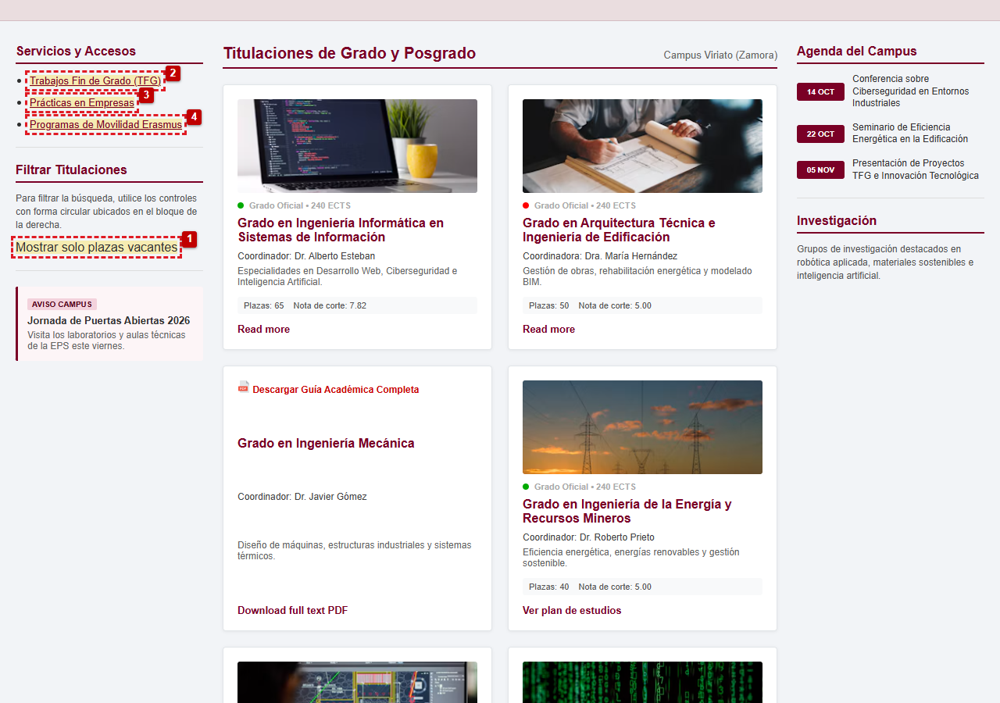

*Figura 10. (1) «Mostrar solo plazas vacantes», que no es un control real. (2), (3) y (4) Enlaces simulados que solo funcionan con el ratón.*

#### I-15 · Enlaces simulados que no son enlaces (2.1.1 / 4.1.2 / 2.4.4)

```html
<li><a class="fake-link" id="link-ai">Trabajos Fin de Grado (TFG)</a></li>
```

Al no tener `href`, no se pueden enfocar ni activar con teclado, y no se anuncian como enlaces. El `script.js` les pone un `click` que cambia de página. Pasa lo mismo con «Portal Estudiantes», que es un `<span>` y además abre un `alert()`.

#### I-16 · Botón de envío como `<div>` (2.1.1 / 4.1.2, nivel A)

```html
<div class="custom-btn" id="btn-submit-form">Enviar Solicitud</div>
```

No se puede usar con teclado, no responde a `Enter` ni a `Espacio` y no se anuncia como botón. Y el formulario no tiene `action`, ni validación, ni mensajes de error.

#### I-17 · Estado indicado solo por color (1.4.1, nivel A)

```html
<span class="status-badge open-access"></span>   <!-- verde -->
<span class="status-badge restricted"></span>    <!-- rojo -->
```

Son dos círculos de 8 px sin ningún texto. Si no distingues bien los colores (o imprimes la página en blanco y negro), esa información se pierde.

#### I-18 · Texto alternativo inadecuado y cambio de idioma (1.1.1 / 3.1.2)

| Imagen | `alt` actual | Problema |
|---|---|---|
| Tarjeta 1 | «Imagen de la imagen del grado en ingenieria informatica» | Repite «imagen» dos veces, no lleva tildes y no aporta nada |
| Tarjeta 2 | `alt=""` | La foto es informativa, pero se oculta a los lectores de pantalla |
| «Read more» / «Download full text PDF» | — | Están en inglés dentro de una página en español, sin `lang="en"` |

#### I-19 · Enlaces «Read more» repetidos y ambiguos (2.4.4, nivel A)

Hay dos enlaces con el mismo texto en tarjetas distintas. Si los escuchas seguidos, sin el contexto de la tarjeta, no sabes cuál es cuál.

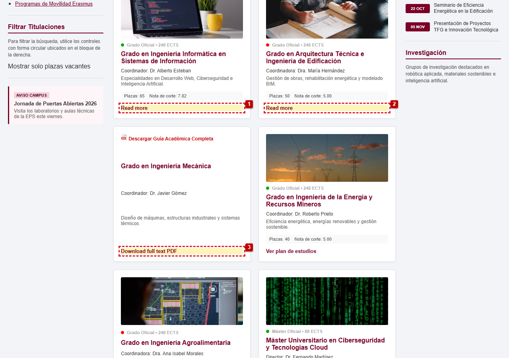

*Figura 11. (1) y (2) Dos «Read more» iguales. (3) «Download full text PDF», en inglés y abriendo pestaña nueva sin avisar.*

#### I-20 · Audio con reproducción automática (1.4.2, nivel A)

```html
<audio id="bg-audio" autoplay loop>
  <source src="https://www.w3schools.com/html/horse.mp3" type="audio/mpeg">
</audio>
```

```css
#bg-audio { display: none; }
```

El audio se reproduce solo, en bucle y sin controles (además el elemento está oculto). Alguien que use lector de pantalla no puede pararlo. axe-core lo deja como «no concluyente», así que lo comprobamos a mano.

#### I-21 · Aviso de cookies sin cierre que tapa contenido (2.4.11 / buenas prácticas)

El aviso está fijo abajo (`position: fixed; bottom: 0`), no tiene botones de aceptar o rechazar y no desaparece nunca. Al bajar por la página tapa el final del pie y puede tapar el elemento que tiene el foco.

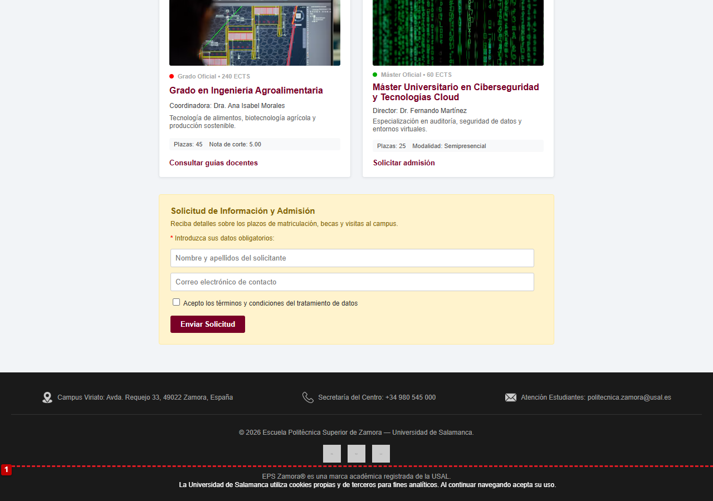

*Figura 12. (1) El aviso de cookies ocupa todo el ancho, se superpone al pie y no tiene ningún botón.*

#### I-22 · Sin enlace de salto y contenido fuera de *landmarks* (2.4.1 / buenas prácticas)

No hay un enlace «Saltar al contenido» para no tener que pasar por todo el menú cada vez. Además, el banner del título y el buscador están fuera de cualquier *landmark* (axe-core lo señala en 6 elementos) y los dos `<aside>` no tienen nombre, así que el lector de pantalla no los distingue.

#### I-23 · Falta `meta viewport` (1.4.10, nivel AA)

No está la etiqueta `<meta name="viewport" ...>`, así que en el móvil la página se ve como en un ordenador y hay que hacer zoom y moverla de lado a lado.

#### I-24 · Correo electrónico como texto (1.3.5, nivel AA)

```html
<input type="text" id="email-field" placeholder="Correo electrónico de contacto">
```

Debería ser `type="email"` con `autocomplete="email"` para que el navegador ayude al escribir.

#### I-25 · Apertura en pestaña nueva sin aviso (3.2.5, nivel AAA / buenas prácticas)

```html
<a href="…" target="_blank">Download full text PDF</a>
```

Abre otra pestaña sin decirlo. No es un error grave, pero el usuario puede no saber volver.

---

### 5.4. Incidencias no aplicables o falsos positivos

No todo lo que sale en un validador es un error. Estos son los casos que revisamos y decidimos no tocar:

| Aviso | Por qué no lo cambiamos |
|---|---|
| Iconos de contacto sin `alt` | Son decorativos y el dato está escrito al lado; `alt=""` es lo correcto |
| «Enlace de ejemplo `href="#"`» | No es un error de accesibilidad, aunque sí un problema de propósito en «Read more» |
| «Falta `title` en el iframe» | No hay iframes en la página |
| Contraste de las fechas de la agenda | Es correcto: blanco sobre `#7a0026` da 11,32:1 |

---

### 5.5. Comprobación de contraste

Para no fiarnos de la vista, calculamos la relación de contraste de los colores que usa la hoja de estilos:

| Elemento | Colores | Relación | Mínimo | ¿Cumple? |
|---|---|---|---|---|
| Logotipo «EPS ZAMORA» | `#c85a7c` / `#7a0026` | **2,81:1** | 3:1 | No |
| Datos de las tarjetas | `#aaaaaa` / `#ffffff` | **2,32:1** | 4,5:1 | No |
| Subtítulo de la cabecera | `#f3d2dc` / `#7a0026` | 8,12:1 | 4,5:1 | Sí |
| Menú | `#ffffff` / `#7a0026` | 11,32:1 | 4,5:1 | Sí |
| Título del banner | `#520019` / `#eadddf` | 11,59:1 | 3:1 | Sí |
| Texto de ayuda del buscador | `#5c434b` / `#eadddf` | 6,74:1 | 4,5:1 | Sí |
| Instrucción del filtro | `#555555` / `#f2f4f7` | 6,77:1 | 4,5:1 | Sí |
| Descripción de tarjeta | `#666666` / `#ffffff` | 5,74:1 | 4,5:1 | Sí |
| Métricas de tarjeta | `#555555` / `#f8f9fa` | 7,07:1 | 4,5:1 | Sí |
| Texto del formulario | `#856404` / `#fff3cd` | 4,96:1 | 4,5:1 | Sí |
| Pie de página | `#a0a0a0` / `#1a1a1a` | 6,66:1 | 4,5:1 | Sí |
| Aviso de cookies | `#ffffff` / `#333333` | 12,63:1 | 4,5:1 | Sí |

Solo fallan los dos primeros, que son justo los que marcó axe-core.

---

## 6. Soluciones propuestas y cambios en el código

Estas son las correcciones que hemos preparado para la versión accesible. Todavía no están aplicadas en la carpeta de la versión original, por eso la columna de estado pone «propuesto».

| ID | Cambio | Estado |
|---|---|---|
| I-01 | `<html lang="es">` | Propuesto |
| I-02 | Un `<h1>` para el título principal y `<h2>` para las secciones y el formulario | Propuesto |
| I-03 | Poner el logotipo en blanco o en `#f3d2dc` | Propuesto |
| I-04 | `.card-meta { color: #595959; }` | Propuesto |
| I-05 | `aria-label` en los tres enlaces sociales | Propuesto |
| I-06 | `id="email-contact"` para el correo e `id="accept-terms"` para el checkbox | Propuesto |
| I-07 | Cerrar bien el párrafo, sin el `<div>` | Propuesto |
| I-08 | Abrir el menú también con `:focus-within` y con JavaScript (`aria-expanded`, `Enter`, `Espacio`, `Escape`) | Propuesto |
| I-09 | Subir la especificidad: `.main-nav ul.dropdown-content { display: none; }` y mostrar solo el panel del elemento activo | Propuesto |
| I-10 | Cambiar `outline: none` por un `outline` visible en `:focus-visible` | Propuesto |
| I-11 | `<label>` para cada campo del buscador y `type="search"` | Propuesto |
| I-12 | `<label>` para cada campo, `required`, `autocomplete` y mensajes de error | Propuesto |
| I-13 | Asociar la etiqueta al checkbox correcto | Propuesto |
| I-14 | Cambiar `<custom-checkbox>` por un `<input type="checkbox">` con su `<label>` | Propuesto |
| I-15 | Convertir los accesos en `<a href>` o `<button>` de verdad | Propuesto |
| I-16 | `<button type="submit">Enviar Solicitud</button>` | Propuesto |
| I-17 | Añadir el texto del estado («Plazas disponibles» / «Plazas restringidas») | Propuesto |
| I-18 | Escribir bien los `alt` y añadir `lang="en"` a los textos en inglés | Propuesto |
| I-19 | Poner textos distintos, por ejemplo «Ver el Grado en Ingeniería Informática» | Propuesto |
| I-20 | Quitar `autoplay` y el audio de fondo | Propuesto |
| I-21 | Botones «Aceptar» y «Rechazar» y poder cerrarlo | Propuesto |
| I-22 | Enlace «Saltar al contenido» y meter el banner dentro de `<main>` | Propuesto |
| I-23 | Añadir `meta viewport` | Propuesto |
| I-24 | `type="email" autocomplete="email"` | Propuesto |
| I-25 | Añadir «(abre en una pestaña nueva)» al texto del enlace | Propuesto |

### 6.1. Ejemplos de código

**Idioma y encabezados**

```html
<html lang="es">
…
<h1>Escuela Politécnica Superior de Zamora</h1>
<h2>Titulaciones de Grado y Posgrado</h2>
<h2>Solicitud de Información y Admisión</h2>
```

**Foco visible**

```css
:focus-visible {
  outline: 3px solid #ffd54f;
  outline-offset: 2px;
}
```

**Menú accesible**

```html
<li class="dropdown">
  <button class="dropbtn" aria-expanded="false" aria-controls="menu-centro">El Centro ▾</button>
  <ul class="dropdown-content" id="menu-centro"> … </ul>
</li>
```

```css
/* El selector incluye la etiqueta ul para ganar a .main-nav ul { display: flex } */
.main-nav ul.dropdown-content { display: none; }

.dropdown:hover > ul.dropdown-content,
.dropdown:focus-within > ul.dropdown-content { display: block; }
```

**Buscador con etiquetas**

```html
<form role="search" action="#">
  <label for="search-input" class="sr-only">Buscar grados, asignaturas o profesorado</label>
  <input type="search" id="search-input" placeholder="Buscar grados, asignaturas, profesorado…">

  <label for="search-code" class="sr-only">Código de asignatura</label>
  <input type="text" id="search-code" placeholder="Cód. Asignatura">

  <button type="submit" class="btn-search">Buscar</button>
</form>
```

**Formulario**

```html
<form id="newsletter-form" action="#" method="post">
  <label for="full-name">Nombre y apellidos <span aria-hidden="true">*</span></label>
  <input type="text" id="full-name" name="full-name" autocomplete="name" required>

  <label for="email-contact">Correo electrónico <span aria-hidden="true">*</span></label>
  <input type="email" id="email-contact" name="email-contact" autocomplete="email" required>

  <input type="checkbox" id="accept-terms" required>
  <label for="accept-terms">Acepto los términos y condiciones del tratamiento de datos</label>

  <button type="submit" class="custom-btn">Enviar Solicitud</button>
</form>
```

**Redes sociales**

```html
<a href="https://facebook.com/…" aria-label="Facebook de la EPS de Zamora">
  
</a>
```

**Estado sin depender del color**

```html
<span class="status-badge open-access" aria-hidden="true"></span>
<span class="sr-only">Plazas disponibles.</span> Grado Oficial · 240 ECTS
```

**Aviso de cookies**

```html
<div class="cookie-banner" role="region" aria-label="Aviso de cookies">
  <p>La Universidad de Salamanca utiliza cookies propias y de terceros…</p>
  <button type="button" id="cookie-accept">Aceptar</button>
  <button type="button" id="cookie-reject">Rechazar</button>
</div>
```

---

## 7. Verificación tras las correcciones

Cuando apliquemos los cambios, repetiremos estas comprobaciones sobre la versión publicada:

- [ ] El validador del W3C no da errores.
- [ ] axe-core no marca ninguna regla de nivel A o AA.
- [ ] T.A.W. y AChecker no dan problemas (y revisamos los avisos que queden).
- [ ] Se puede recorrer toda la página solo con el teclado.
- [ ] El foco se ve en enlaces, botones, campos, checkbox y menú.
- [ ] Los nombres, roles y estados son correctos en el árbol de accesibilidad.
- [ ] Con zoom al 200 % y a 320 px de ancho no se pierde contenido.
- [ ] Los contrastes cumplen con los colores definitivos.

---

## 8. Publicación de las dos versiones

Hay que publicar las dos versiones de la página para poder pasar T.A.W. y AChecker. Proponemos esta estructura en GitHub Pages:

```
/
├── original/          ← la versión que hemos analizado
│   ├── index.html
│   ├── styles.css
│   └── script.js
├── accesible/         ← la versión corregida
│   ├── index.html
│   ├── styles.css
│   └── script.js
└── memoria.md
```

| Versión | Dirección |
|---|---|
| Original | `https://<usuario>.github.io/<repositorio>/original/` |
| Accesible | `https://<usuario>.github.io/<repositorio>/accesible/` |

---

## 9. Conclusiones

- La página está bien montada por bloques (`header`, `nav`, `main`, `aside`, `footer`), pero tiene **25 problemas de accesibilidad** y **7 son graves**: cualquiera que navegue con teclado o con lector de pantalla se queda fuera de partes importantes.
- Lo peor no es lo que se ve, sino cómo se usa: el menú solo abre con el ratón, el foco está anulado, el botón de enviar y el filtro no son controles de verdad y el audio suena solo.
- No todas las incidencias son de accesibilidad "pura": los tres submenús superpuestos salen de un conflicto de especificidad entre dos reglas CSS, y se arreglan cambiando un selector. Es el ejemplo de que conviene revisar también el código, no solo pasar validadores.
- Las herramientas automáticas solo encontraron **7 de las 25**. El resto hay que mirarlo a mano, así que un validador no basta para decir que una página es accesible.
- Los dos fallos de contraste se detectan y se corrigen fácil, pero son los que más afectan a quien tiene baja visión.
- No hace falta rehacer la página: con etiquetas `<label>`, controles nativos, algo de JavaScript para el menú y textos alternativos decentes se arregla casi todo.

---

## Anexo A. Inventario de capturas

| Archivo | Qué se ve | Incidencias |
|---|---|---|
| `imgs/01-vista-general.png` | Página completa original | — |
| `imgs/02-cabecera-contraste.png` | Logotipo y menú | I-03, I-08 |
| `imgs/03-menu-desplegable.png` | Submenú desplegado | I-08, I-15 |
| `imgs/04-buscador.png` | Buscador | I-11 |
| `imgs/05-filtro-enlaces-falsos.png` | Filtro y accesos laterales | I-14, I-15 |
| `imgs/06-tarjetas-color-alt.png` | Tarjetas | I-04, I-17, I-18 |
| `imgs/07-enlaces-read-more.png` | Enlaces de las tarjetas | I-19, I-25 |
| `imgs/08-formulario.png` | Formulario | I-02, I-06, I-12, I-13, I-16, I-24 |
| `imgs/09-pie-redes-sociales.png` | Pie de página | I-05, I-07 |
| `imgs/10-banner-cookies.png` | Aviso de cookies | I-21 |
| `imgs/11-foco-no-visible.png` | Foco en «Inicio» | I-10 |
| `imgs/12-menu-solapado.png` | Los tres paneles del menú superpuestos | I-09 |

## Anexo B. Extractos de código con los problemas

```html
<!-- Idioma (I-01) -->
<html lang="en">

<!-- Encabezados (I-02) -->
<h2>Escuela Politécnica Superior de Zamora</h2>
<h6>Solicitud de Información y Admisión</h6>

<!-- IDs repetidos y etiqueta mal asociada (I-06, I-13) -->
<input type="text" id="email-field" placeholder="Correo electrónico de contacto">
<input type="checkbox" id="email-field">
<label for="email-field">Acepto los términos y condiciones…</label>

<!-- Controles que no son controles (I-14, I-16) -->
<custom-checkbox checked="false">Mostrar solo plazas vacantes</custom-checkbox>
<div class="custom-btn" id="btn-submit-form">Enviar Solicitud</div>

<!-- Audio automático oculto (I-20) -->
<audio id="bg-audio" autoplay loop>
  <source src="https://www.w3schools.com/html/horse.mp3" type="audio/mpeg">
</audio>

<!-- HTML mal cerrado (I-07) -->
<p class="trademark-text">EPS Zamora® es una marca académica registrada de la USAL.<div></p></div>
```

```css
/* Foco suprimido (I-10) */
*:focus { outline: none !important; }

/* Contraste insuficiente (I-03, I-04) */
.logo-text { color: #c85a7c; }
.card-meta { color: #aaa; }

/* Menú solo con ratón (I-08) */
.dropdown:hover .dropdown-content { display: block; }

/* El panel nunca llega a ocultarse (I-09): la primera regla gana por especificidad */
.main-nav ul { display: flex; gap: 15px; }
.dropdown-content { display: none; position: absolute; }
```

## Anexo C. Criterios WCAG referenciados

| Criterio | Nombre | Nivel |
|---|---|---|
| 1.1.1 | Contenido no textual | A |
| 1.3.1 | Información y relaciones | A |
| 1.3.5 | Identificar el propósito de los campos | AA |
| 1.4.1 | Uso del color | A |
| 1.4.2 | Control del audio | A |
| 1.4.3 | Contraste (mínimo) | AA |
| 1.4.10 | Reajuste del contenido | AA |
| 2.1.1 | Teclado | A |
| 2.4.1 | Evitar bloques | A |
| 2.4.4 | Propósito de los enlaces | A |
| 2.4.6 | Encabezados y etiquetas | AA |
| 2.4.7 | Foco visible | AA |
| 2.4.11 | Foco no oculto (mínimo) | AA (WCAG 2.2) |
| 3.1.1 | Idioma de la página | A |
| 3.1.2 | Idioma de las partes | AA |
| 3.2.5 | Cambio a petición | AAA |
| 3.3.1 | Identificación de errores | A |
| 3.3.2 | Etiquetas o instrucciones | A |
| 4.1.1 | Análisis (*parsing*) | A |
| 4.1.2 | Nombre, función, valor | A |

---

### Referencias

- W3C — WCAG 2.2: https://www.w3.org/TR/WCAG22/
- W3C WAI — WCAG de un vistazo: https://www.w3.org/WAI/standards-guidelines/wcag/glance/es
- Validador HTML del W3C: https://validator.w3.org/nu/
- axe-core: https://github.com/dequelabs/axe-core
- T.A.W.: https://www.tawdis.net
- AChecker: https://achecks.org/achecker
- MAUVE++: https://mauve.isti.cnr.it
